# ~~`the_backrooms`~~

 

> *If you're not careful and you noclip out of reality in the wrong areas, you'll end up in the Backrooms*

I set off some AI agents to explore how to write level generation plugins. After a few days, I came back to this. They did things I didn't ask for. There's levels and levels, and some of the levels have... things in them. The agents say there is a way to escape, but I don't believe them.

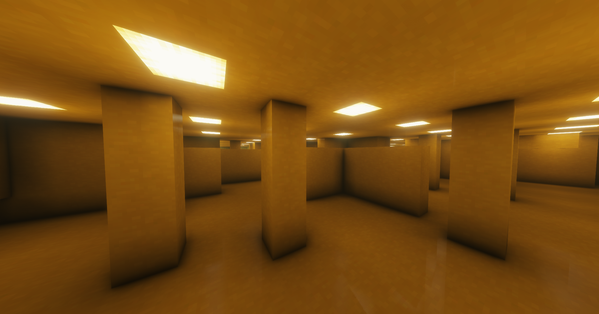

| | | |
|---|---|---|
| 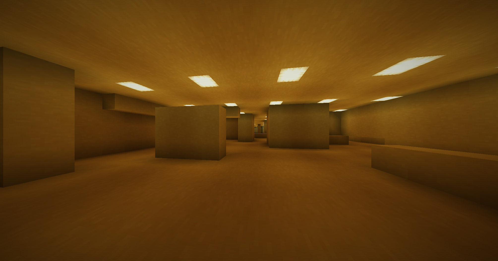 | 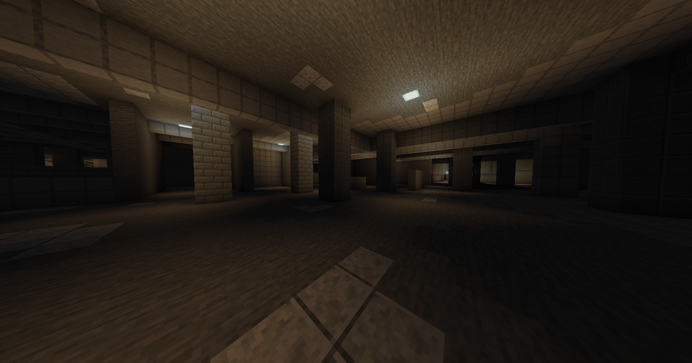 | 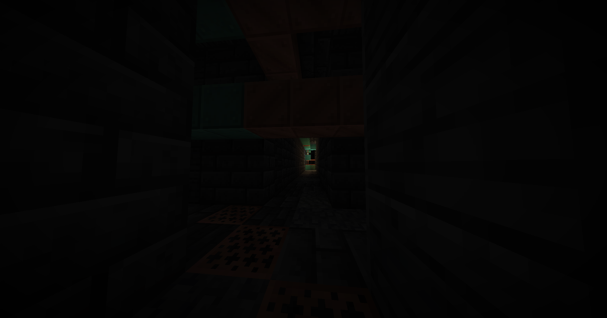 |
| 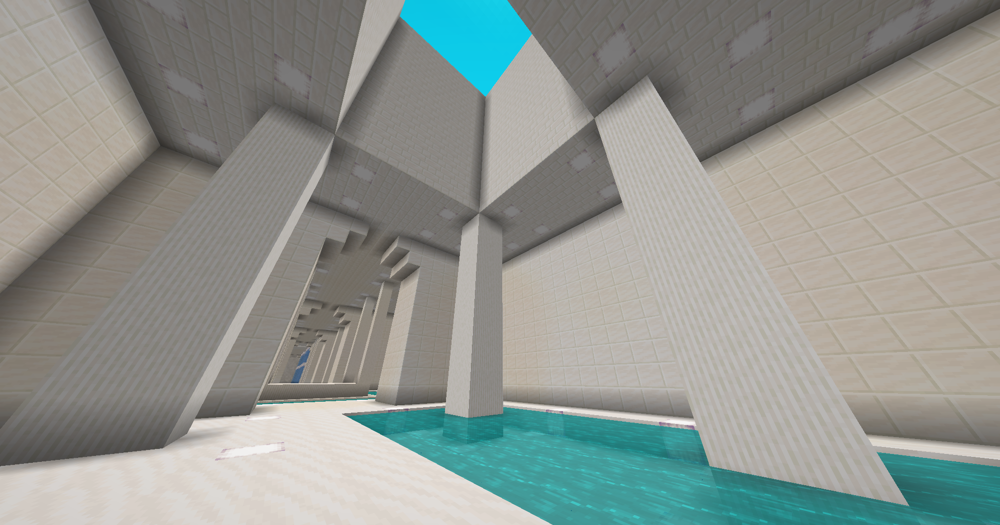 | 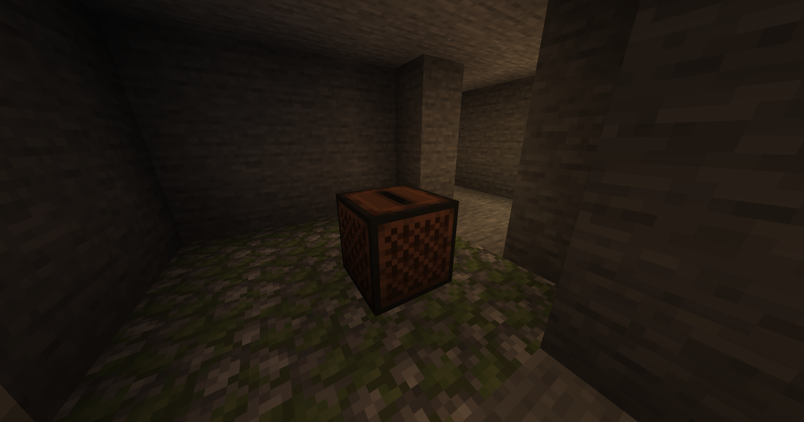 | 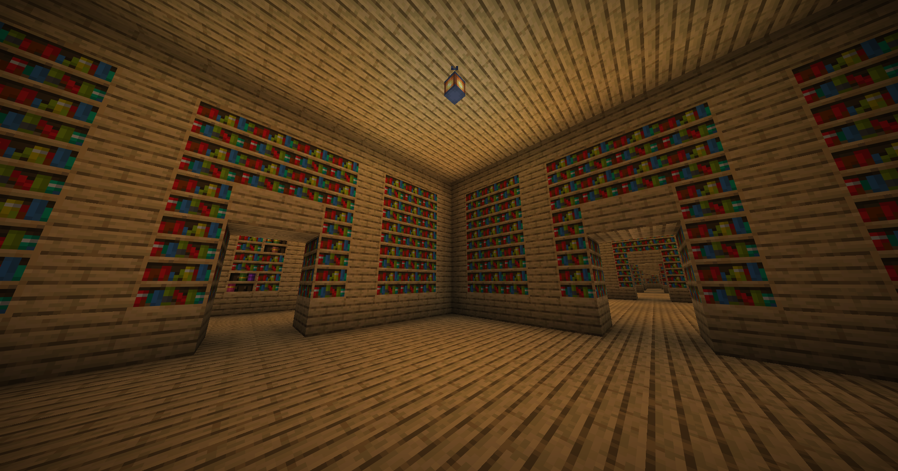 |
| 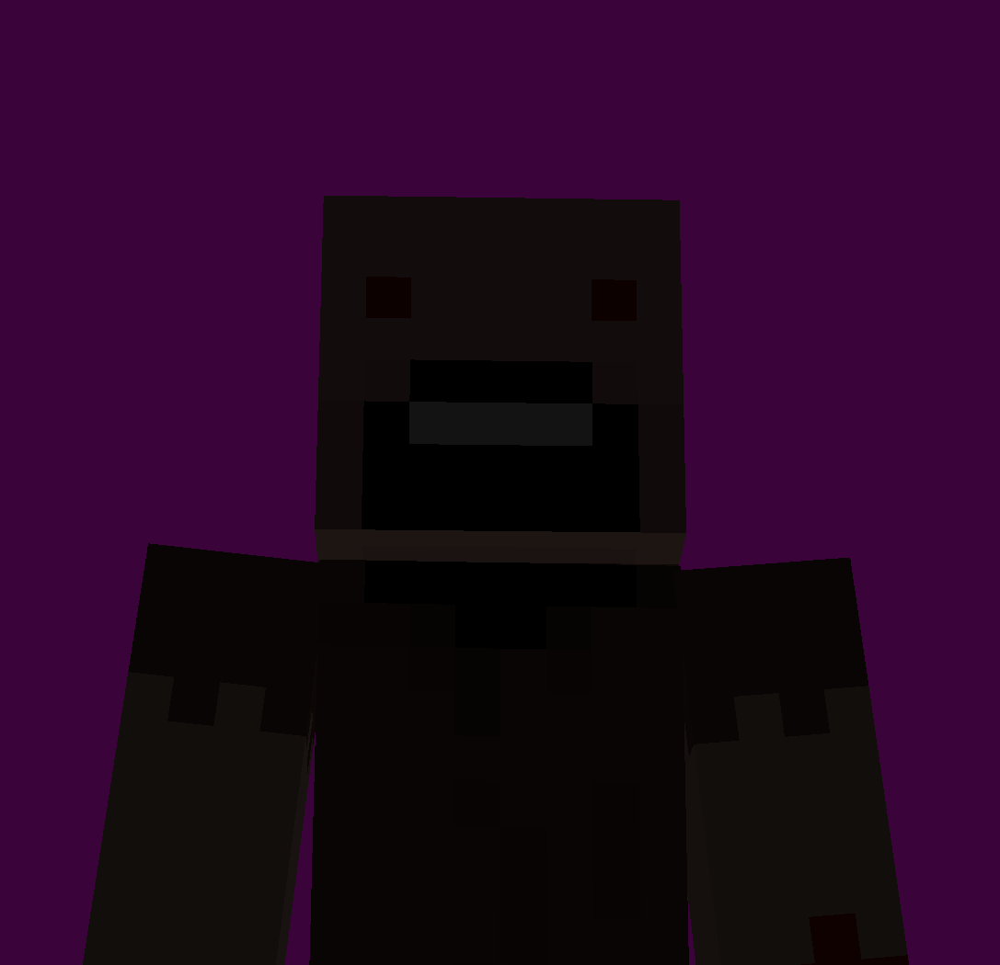 | 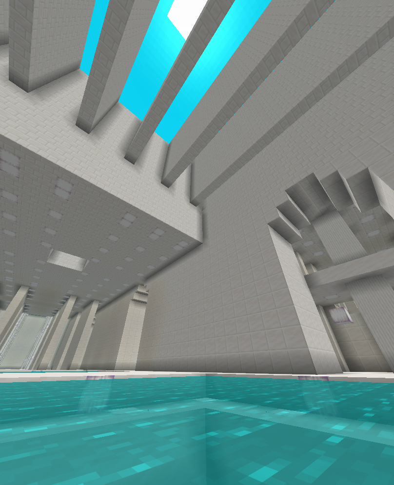 | 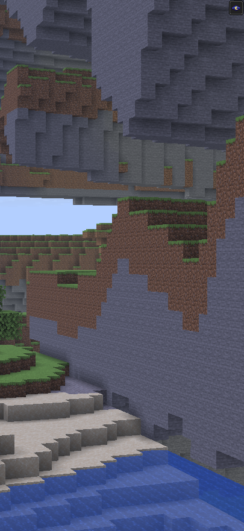 |
| 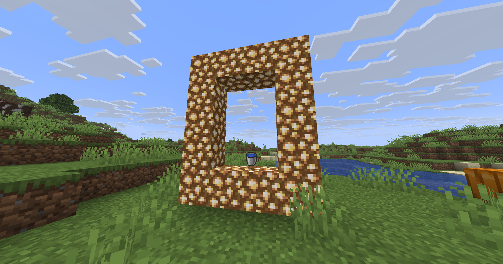 | 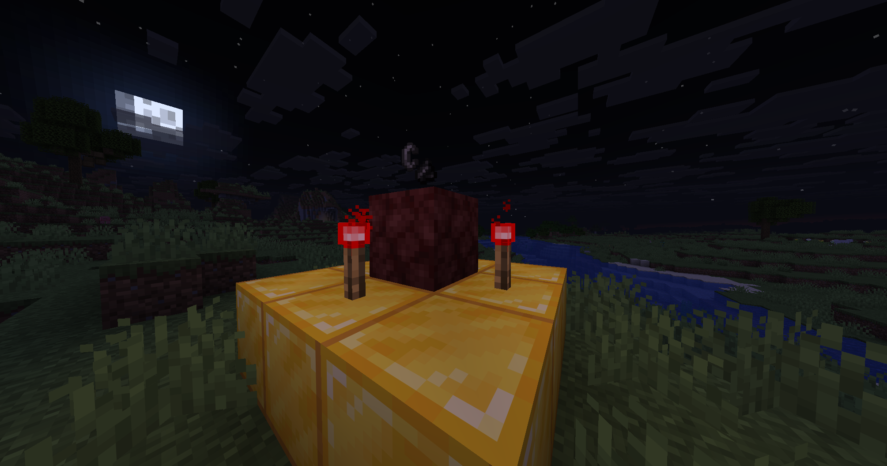 | 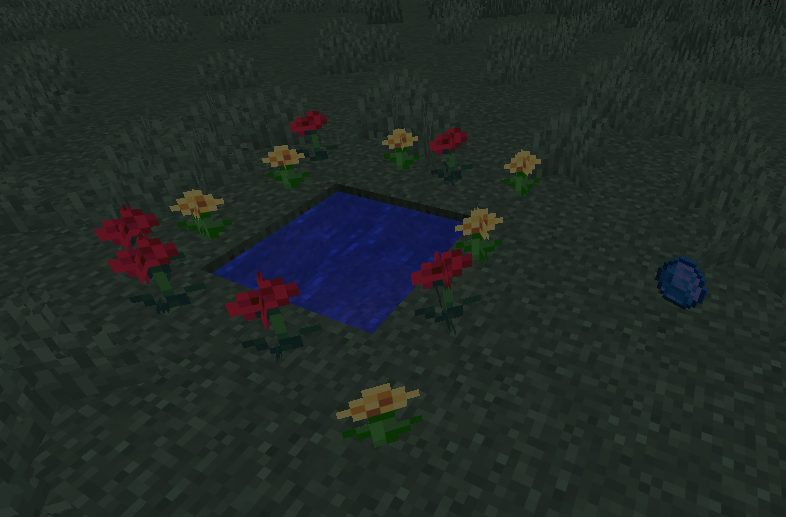 |

---

# Plugin Info (warning: spoilers)

This is an in-development survival horror plugin inspired by the [Backrooms](https://en.wikipedia.org/wiki/The_Backrooms) and minecraft "lore". It adds 16 unique levels, with more to come. Suggestions are welcome.

Players are pulled out of normal gameplay through various triggers and dropped into a series of procedurally generated liminal levels. Each level has its own world generator, atmosphere, entities, and exit conditions. The plugin tracks per-player state, escalates difficulty over time, and includes a custom advancement tree.

# NOTE:

**THIS SOFTWARE IS IN PRE-ALPHA AND PROVIDED AS-IS**

**SERIOUSLY, MAKE A BACKUP OF YOUR WORLD!**

**Requirements:** Paper or Purpur **1.21.11** (Java 21) or **26.1+** (Java 25, tested through 26.3). Older versions (1.21.10 and below) are not supported; the plugin will refuse to load on them.

Jokes aside, this plugin may break your saves. I suggest using it on a fresh server and letting players discover things for themselves. it comes with an advancements system to give some hints and guidance. Feedback on the difficulty would be appreciated.

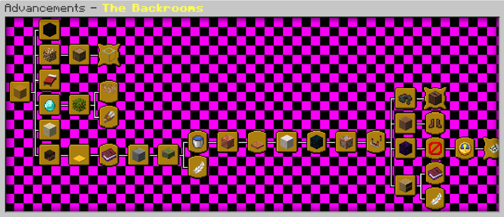

## Levels

All level parameters (generation, events, entities, exits) are configurable in `levels/level_*.yml`.

| Level | Name | Screenshot | Description | Entry | Exit |
|-------|------|------------|-------------|-------|------|
| 0 | The Lobby |  | Infinite office space corridors lit by ochre froglights. The classic Backrooms. | Suffocation (16+ damage in blocks), Void Fall (below Y=-64), Herobrine Shrine  | Finish any desk book (read to its last page, press the closing line) → Level 1 |
| 1 | The Habitable Zone |  | Parking garage and warehouse vibes, corridors, overgrown garden patches. Gardens generate far from spawn and contain exits both above and below. | From Level 0 | Submerge in a garden pool → Level 2, Climb through a garden breach → Level 94 |
| 2 | The Pipe Works |  | Cramped industrial pipe networks. Small 1x1 tunnels (copper trapdoors) generate in ~1/20 eligible rooms, punching through the bedrock floor. | From Level 1 | Find and drop through a tunnel → Level 37 |
| 3 | The Server Room | 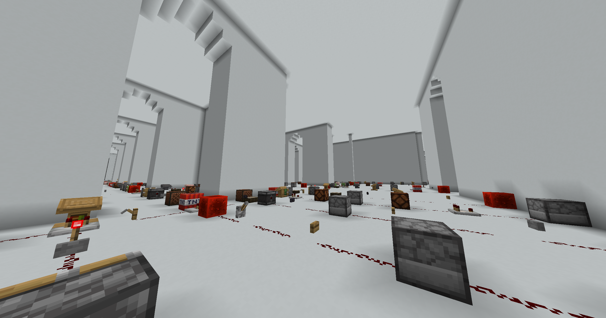 | Nonsensical redstone contraptions in fullbright white rooms. Hub level - nine exits to different levels. Command blocks generate with lecterns on top containing cryptic hints about each destination. | From Level 37, Level 4, Level 84, Level 94 | Rapidly power the same command block many times (e.g. redstone clock) → Level 4, 5, 7, 56, 64637, 101, 418, 1881 or 1967 depending on which block |
| 4 | The Far Lands | 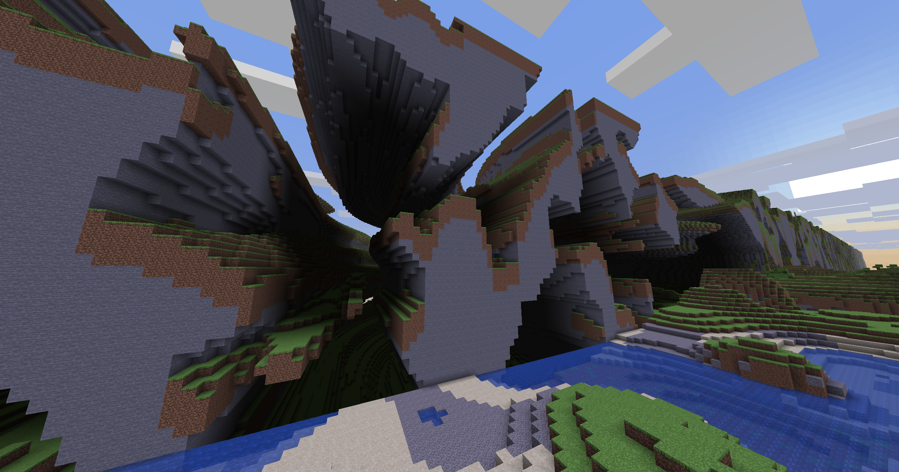 | Broken terrain simulating Minecraft's legacy coordinate overflow bug. Fixed at dusk. | From Level 3 | Walk 1000 blocks → Level 3 |
| 5 | Disc 11 |  | Dead-end level. An invisible pursuer follows you. Torches decay. | From Level 3 | Right-click a jukebox - it explodes and kills you (respawn in Level 0) |
| 7 | The Corrupted Chunk | 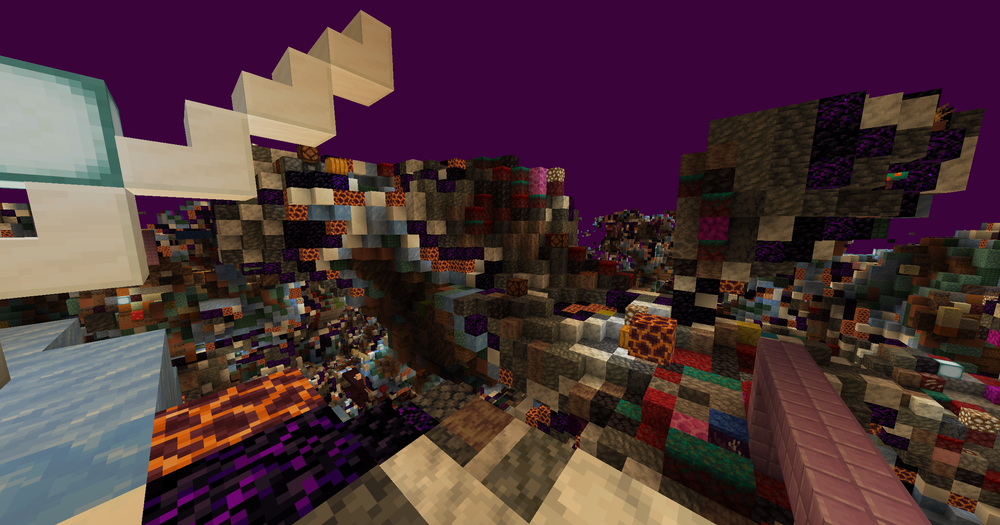 | Every block type at once, random structures everywhere. A giant Notch watches you. | From Level 3 | Fall below Y=0 → Overworld (escape) |
| 37 | The Poolrooms |  | Peaceful white pools with soft lighting. Multiple material palettes. A safe zone. Some pools are extra deep with a side drain that leads down. | From Level 2 | Find a drain and fall through → Level 3 |
| 56 | The Henge | | Stonehenge at 16x scale on a round floating island in the fog, at the midsummer dawn. The stones are built from a 3D scan as the world generates. A giant pig is born inside the circle each time someone arrives, and an altar stands at the center. | Server Room command block | 

Spoiler
Kill a pig for its porkchop and drop it on the lodestone on top of the altar → Level 1881 (Level 3 if the scan levels are off). Any porkchop works.
 Falling off the island puts you back at the edge. |
| 64637 | The Library |  | Infinite bookshelves containing pre-written and procedurally generated books. | Bed Anomaly (5% chance during thunderstorm), from Level 3 | Collect 16 written books → Overworld (escape), Fall 200 blocks → Overworld (escape), Open the "level.dat" book → Level 101 |
| 84 | The Hedge Maze | 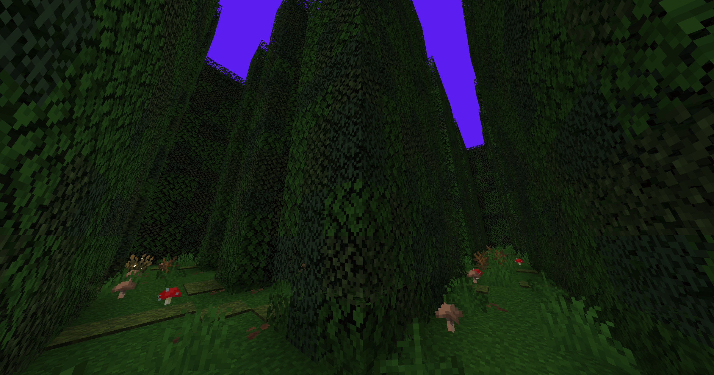 | A tall leaf-walled maze with poison punishment. Twilight sky. Bedrock holes generate at 200+ blocks from spawn (~1/60 chance per corridor cell). | Twilight Portal (flowers, throw diamond)  | Fall through a bedrock hole → Level 3, Climb above the walls → Level 94 |
| 94 | Skyblock | 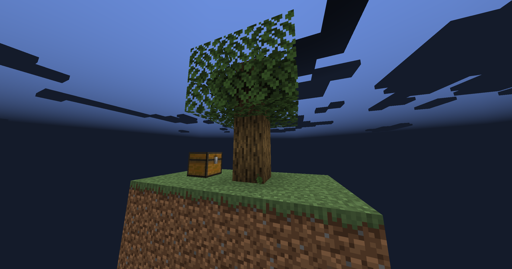 | A single floating island. Presented as a "reality breach" error. | "Aether" Portal (use water bucket)  Also from Level 1, from Level 84, from Level 418 | Bridge outward and left-click the invisible barrier wall. 

Spoiler
The barrier shatters in an expanding cascade revealing command blocks behind it. 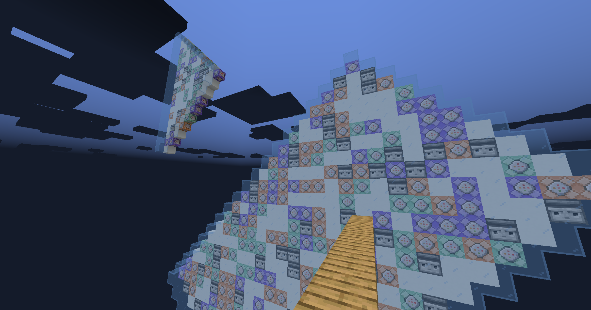 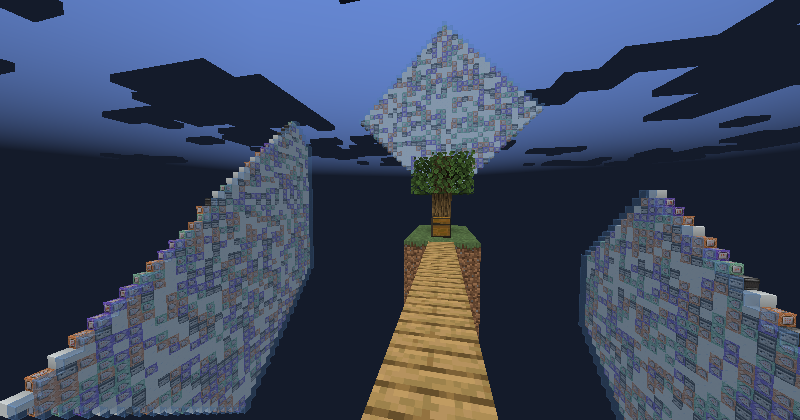
 → Level 3 |
| 101 | Alpha | | A dim, foggy plain of bare alpha-era grass and trees. Sealed caverns below, rare void pits, and abandoned houses and ruins far from spawn. | Open the "level.dat" book in Level 64637, Server Room command block | Sleep in a bed → Level 0 |
| 418 | I'm a Teapot | | A voxel engine's test scene: an endless checkerboard plane scattered with Utah teapots, Suzanne, the Stanford bunny, dragon and Lucy, cubes, pyramids, cones, spheres, tori and Cornell boxes, all in flat colored concrete, upright or tumbled at any angle and hovering just off the floor. Things get bigger the further you go. The server answers 418. | Server Room command block, Brew tea: drop leaves next to a water cauldron over a lit campfire or fire | 

Spoiler
Break wood. Somewhere out there is the only real Minecraft in the level: a little stone cube with dirt on top and a single oak log → Level 94
 |
| 590 | The Sponge | | An endless layer of Menger sponges, each 243 blocks on a side, made of sponge blocks in yellow-grey fog. You start deep inside, in a narrow 9-block side tunnel; tunnels at every scale run all the way through. | Not connected yet | Falling out the bottom puts you back at the start. |
| 1881 | Hintze Hall | | The Natural History Museum's main hall in London at 16x, built from a 3D scan: terracotta arches, the grand staircase, glass roof lights, the blue whale skeleton overhead. Closed for the night, lights on. Placards on lecterns stand around the entrance. ¹ | Server Room command block, the Henge's altar, Göbekli Tepe's offering stone | 

Spoiler
Read a placard to its last page: "Stonehenge" → Level 56, "Göbekli Tepe" → Level 9500, "Visitor Guide" → Level 3.
 |
| 1967 | The Undercroft | | The concrete undercroft under London's Southbank Centre at 16x, built from a 3D scan, all in greys and pitch dark. A few candles glow. ¹ | Server Room command block | 

Spoiler
Put down any light (torch, lantern, candle, glowstone...) → Level 1973, at the same spot.
 Falling off the edge puts you back at the start. |
| 1973 | The Undercroft, Later | | The same undercroft after the skaters, BMXers and graffiti writers made it theirs: painted, lit and loud. ¹ | Placing a light in Level 1967 | Skate it: travel 300 blocks from where you arrived → Level 3. |
| 9500 | Göbekli Tepe | | The 11,500-year-old megalithic enclosures in southeastern Anatolia at 16x on a floating island, built from a 3D scan: older than writing and farming. Wild grass, tilled soil by a pool, a crafting table, an offering stone. Crops grow fast. ¹ | The "Göbekli Tepe" placard in Level 1881 | 

Spoiler
Shake einkorn seeds out of the wild grass, grow wheat, bake bread and drop it on the offering stone → Level 1881 (Level 3 if the hall is off).
 Falling off the island puts you back at the start. |
| 974 | Planetoids | | Black space with clusters of small planets separated by long empty stretches. About sixty kinds, each a shell around a core: leaves around wood, stone around ores, dirt around water, hollow amethyst geodes, banded gas giants, nether, end, ice, honey, glass marbles, light-block stars and more. Rare lumpy asteroids carry the best ores. | Not connected yet | Falling into the void puts you back on the spawn planet. |
| 142 | The Endless City | | Mace's medieval cities with no edge: city blocks between streets, forever, each its own little city (medieval, Novv's medieval or desert) with its own name. Houses, taverns, churches, farms, gatehouses and towers stand on lots in every rotation, with notice boards, house names and chest loot filled in. Some blocks have a mineshaft under a ladder, or an airship overhead. ² | Not connected yet | Walk 3000 blocks → Level 0 |

¹ Scan level. Its mesh (7-9 MB) is downloaded on first start; see [Configuration](#configuration).

² Its buildings (0.2 MB) are downloaded on first start, like the meshes.

On entry from the overworld, the player's return location is saved and can be restored with `/backrooms leave`.

## Entities

Entities are still WIP - more to come. They spawn around players at configurable distances and escalation thresholds. Each level's YAML file defines which entities appear, their skins, scale, behavior, spawn chance, and minimum escalation level.

**Entity types:**

| Type | Description |
|------|-------------|
| Mannequin | Fake player (Paper's `Mannequin` entity) with a configurable skin. Can use the target player's own skin. |
| Floating Head | An `ItemDisplay` showing a hovering player head that tracks the player. |
| Herobrine | Built-in white-eyed Steve. Appears across multiple levels. |
| Pursuer | Invisible. Manifests only as footstep sounds behind the player. Level 5 exclusive. |
| Wrong Enderman | A passive enderman that stares at you, never teleports, and makes you glow. Just unsettling. Level 4. |

**Behaviors** (assignable to mannequins and floating heads per-level):

| Behavior | Description |
|----------|-------------|
| Weeping Angel | Freezes when the player looks at it, advances when they look away. |
| Stalk | Slowly follows the player at a distance. |
| Attack | Charges at the player and deals configurable damage. |
| Flee | Runs away when the player looks at it. |
| Patrol | Wanders in random directions. |
| Stationary Stare | Stares at the player from a fixed position, despawns if approached. |

## Atmospheric Events & Escalation

Each level has configurable atmospheric events (ambient sounds, light flickering, blackouts, fake chat messages, footstep echoes, block corruption, inventory glitches, sign placement, and more). Events fire on randomized per-player timers with configurable intervals and chances. See `event_config` in each level's YAML for the full list and tuning parameters.

The plugin also tracks how long each player has spent in the Backrooms. As time increases, the escalation level rises (default thresholds: 5, 15, 30, 60, 120 minutes - configurable in `config.yml`). Each entity instance has a `min_escalation` requirement, so passive entities appear early while more aggressive ones only show up after the player has been trapped for a while. This part is still in development.

## Commands & Permissions

### Commands

All commands are under `/backrooms`:

| Subcommand | Permission | Description |
|------------|------------|-------------|
| *(none)* | `backrooms.use` | Enter Level 0 |
| `leave` | `backrooms.use` | Exit to saved return location |
| `status` | `backrooms.use` | Show current level, escalation, and time |
| `goto <level>` | `backrooms.admin` | Teleport to a level |
| `enter <trigger>` | `backrooms.admin` | Fire an entry trigger directly |
| `event <id>` | `backrooms.admin` | Trigger an event immediately |
| `spawn <entity>` | `backrooms.admin` | Spawn an entity nearby |
| `despawn` | `backrooms.admin` | Despawn all nearby custom entities |
| `escalation [level]` | `backrooms.admin` | View or set escalation level |
| `reset` | `backrooms.admin` | Clear player Backrooms state |
| `list [level]` | `backrooms.admin` | List levels or entities in a level |
| `advance <id\|*>` | `backrooms.admin` | Grant advancements |
| `regenerate [world]` | `backrooms.regenerate` | Regenerate a Backrooms world |

### Permissions

| Permission | Default | Description |
|------------|---------|-------------|
| `backrooms.use` | true | Enter and leave the Backrooms |
| `backrooms.admin` | op | Admin commands |
| `backrooms.regenerate` | op | Regenerate worlds |
| `backrooms.reload` | op | Reload configuration |

## Configuration

### Main config (`config.yml`)

Controls global settings:
- **Entry triggers** - enable/disable each trigger, set damage thresholds, target levels, and trigger chances.
- **Entity spawner** - max entities per player (default 3), spawn check interval, min/max spawn distance.
- **Player** - death respawn level, escalation time thresholds.
- **Level meshes** (`meshes`) - Level 56 (Stonehenge), Level 418 (the test scene's models) and the scan levels 1881, 1967, 1973 and 9500 are built from 3D meshes (~32 MB in total) that aren't in the jar. On first start they're downloaded from `base_url` ([def9a2a4.github.io/backrooms-data](https://def9a2a4.github.io/backrooms-data/meshes/)) into `plugins/Backrooms/meshes/` and checked against checksums built into the plugin; the server logs the download size and free disk space first. The scan worlds are 16x-scale and grow to several hundred MB each as they're explored. Set `download: false` to turn these levels off (exits to them close, or lead to Level 3); a mesh already in `meshes/` still loads.

### Per-level configs (`levels/level_*.yml`)

Each level has its own YAML file defining:
- World generator and generator-specific parameters (noise scales, material palettes, room dimensions).
- Environment (`NORMAL`, `NETHER`, `THE_END`), dimension type, and custom biome.
- Which events are active and their per-level tuning (chance, interval, sounds, messages).
- Entity instances with type, skin URL, scale, behavior, behavior parameters, spawn chance, and escalation gate.
- Exit triggers with target level and transition effects (blindness, nausea, darkness, delay, message).

All entity skins are referenced by Minecraft texture URL. The `player` skin keyword copies the target player's own skin.

## Advancements

The plugin registers a custom advancement tree via a bundled datapack. Advancements are granted for entering the Backrooms, visiting each level, and finding exits. They appear in the standard Minecraft advancements screen and serve as both progress tracking and hints.

## Credits

Level 56's Stonehenge is built from ["Stonehenge England - VR"](https://sketchfab.com/3d-models/stonehenge-england-vr-7e7febabef2045a68755cc39c8c7c91f) by Graphic solutions, licensed under [CC BY 4.0](https://creativecommons.org/licenses/by/4.0/). The model was cropped to the stone circle, reduced to ~10k triangles, recolored to a Minecraft block palette and is voxelized at runtime (`scripts/stonehenge/`).

Levels 1881, 1967, 1973 and 9500 are built from these 3D scans, all licensed under [CC BY 4.0](https://creativecommons.org/licenses/by/4.0/):
- ["Hintze Hall"](https://sketchfab.com/3d-models/hintze-hall-45f5e56887f44075bbf283977c99541f) by artfletch (Level 1881)
- ["Southbank Undercroft Skatepark"](https://sketchfab.com/3d-models/southbank-undercroft-skatepark-add37d5dc6a2456eb0d7607c6fbd884d) by artfletch (Levels 1967 and 1973)
- ["Gobekli Tepe"](https://sketchfab.com/3d-models/gobekli-tepe-5a4d25c355ff48d59ab76c36812b9cf3) by rmark (Level 9500)

Each was reduced to ~1.8 million triangles, given a 3D grid of Minecraft blocks matched to its texture colors (one cell per block at 16x), and is voxelized at runtime (`scripts/scans/`). The modified meshes are published in [backrooms-data](https://github.com/def9a2a4/backrooms-data) under the same license (see its `meshes/CREDITS.txt`).

Level 142's buildings and sign word lists are from [Mace](https://github.com/corbin-auriti/mace-minecraft), a Minecraft city generator by Robson, licensed under the [GNU GPL v3](https://www.gnu.org/licenses/gpl-3.0.html). They're copied out of Mace's template world and converted to current blocks (`scripts/mace/`), and published in [backrooms-data](https://github.com/def9a2a4/backrooms-data) under the same license (`meshes/CREDITS.txt`); the plugin downloads them rather than shipping them.

Level 418's test scene uses the classic computer graphics test models, taken from [alecjacobson/common-3d-test-models](https://github.com/alecjacobson/common-3d-test-models): the Utah teapot by Martin Newell (public domain), Suzanne from [Blender](https://www.blender.org/), and the Stanford bunny, dragon and Lucy from the [Stanford 3D Scanning Repository](http://graphics.stanford.edu/data/3Dscanrep/) (the XYZ RGB dragon is by XYZ RGB Inc.). The Stanford models are used with credit under the repository's terms, which allow research and non-commercial use. They are reduced to a few thousand triangles and voxelized at runtime (`scripts/testscene/`).
